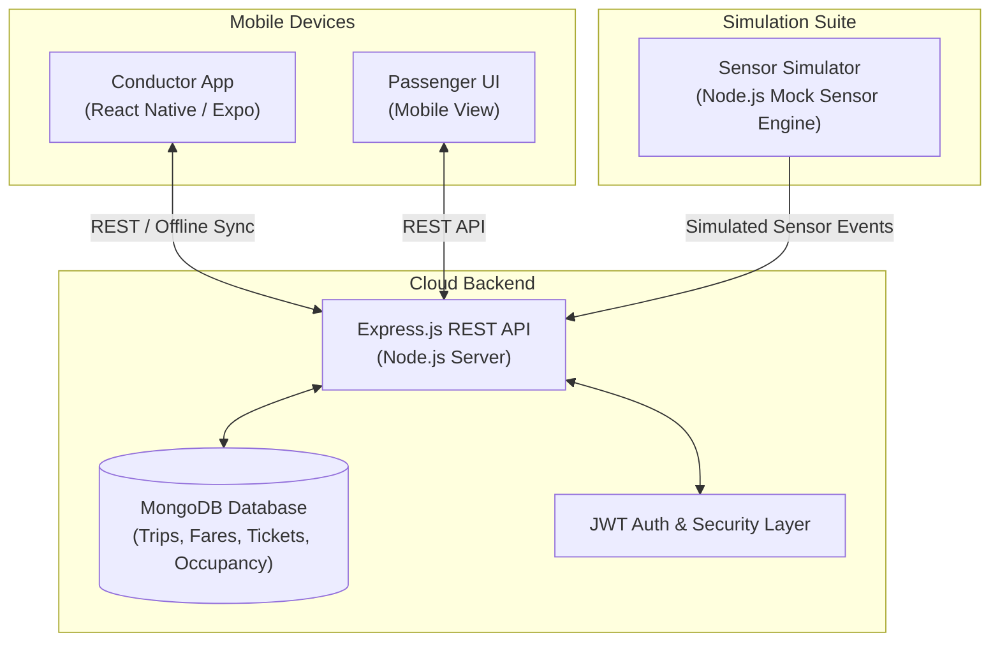
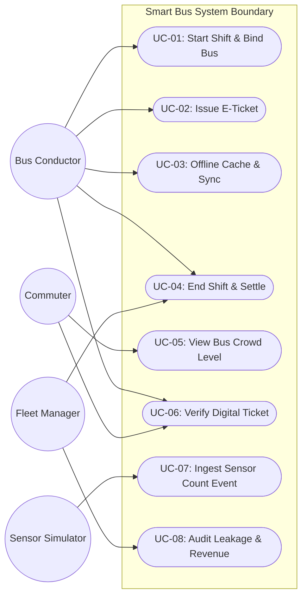

# Software Requirements Specification (SRS)
## Smart Public Bus E-Ticketing & Passenger Counting System

**Standard:** IEEE Std 830-1998 / ISO/IEC/IEEE 29148:2018 Compliant  
**Course:** CSE 3200 — System Development Project  
**Institution:** Rajshahi University of Engineering & Technology (RUET)  
**Department:** Computer Science & Engineering (CSE)  
**Date:** November 2026  
**Version:** 1.0.0  

---

### Project Team

| Member Name | Student ID (Roll) | Project Role |
| :--- | :--- | :--- |
| **Md Asif Sarker** | `2203131` | Lead Builder & System Architect |
| **Wahid Galib** | `2203121` | Quality Auditor, Reviewer & Co-Developer |

---

## 1. Introduction

### 1.1 Purpose
This Software Requirements Specification (SRS) document details the complete functional and non-functional requirements for the **Smart Public Bus E-Ticketing & Passenger Counting System**. It establishes the formal baseline for system architecture, database modeling, mobile client development (React Native / Expo), backend API implementation (Node.js / Express / MongoDB), sensor simulation, and automated testing throughout the CSE 3200 semester project lifecycle.

### 1.2 Document Conventions
- **`FR-xx`**: Functional Requirement identifier.
- **`NFR-xx`**: Non-Functional Requirement identifier.
- **`UC-xx`**: Use Case identifier.
- **`US-xx`**: User Story identifier.
- Requirement priorities are categorized using the **MoSCoW** convention:
  - **M** (Must Have): Mandatory for baseline deployment.
  - **S** (Should Have): High priority; included if feasible within the sprint window.
  - **C** (Could Have): Desirable enhancement.
  - **W** (Won't Have this time): Deferred to future releases.

### 1.3 Intended Audience
- **Course Instructors & Evaluators (CSE 3200):** For grading against academic milestones, verification of requirements engineering, and traceability assessment.
- **Development Team (Asif Sarker & Wahid Galib):** For sprint execution, task allocation, and test design.
- **Autonomous AI Agents (Antigravity & Peer Agents):** For automated code generation, linting, test suite generation, and peer review audits.

### 1.4 Project Scope
The system replaces archaic manual paper ticketing and cash transactions on local intra-city and inter-suburb public bus routes with an integrated software suite:
- A handheld **Conductor Mobile App** capable of rapid, single-hand tap ticketing, distance-based dynamic fare calculation, and offline operation with automatic sync.
- A **Passenger Interface** providing digital ticket receipts, cryptographic QR verification, and real-time route crowding status.
- An **Automated Passenger Counting Simulation Engine** modeling bus door sensor triggers (boarding and alighting) to provide live seat occupancy statistics without physical hardware constraints.
- An **Operator / Transport Authority Management Interface** ensuring transparent trip auditing, fraud prevention, and route demand analytics.

---

## 2. Overall Description

### 2.1 Product Perspective & Context
Public transit in developing urban regions relies almost exclusively on cash and paper ticket booklets. Based on field observations and stakeholder interviews:
1. **Conductors** struggle with physical cash handling in congested moving buses, leading to frequent disputes over small denominations (loose change) and untracked ticket reuse.
2. **Bus Owners/Operators** face revenue leakage estimated at 15–25% due to underreported passenger counts and cash skimming.
3. **Commuters** lack transparency regarding dynamic distance-based fares and have no visibility into how crowded approaching buses are.

Existing digital booking platforms (such as *bdtickets*, *Shohoz*, and *Akota*) exclusively target long-distance intercity coach travel with mandatory advance seat reservations. They fail in local transit, which requires sub-second tap-and-go ticketing and standing passenger management.



### 2.2 User Classes and Characteristics
1. **Bus Conductor (Primary Operator):**
   - **Profile:** Non-technical, operates under high pressure inside crowded, jolting vehicles.
   - **Needs:** Minimal cognitive load, high-contrast UI, rapid tap-to-issue (< 2 seconds per passenger), and zero failure during intermittent network connectivity.
2. **Daily Commuter (End User):**
   - **Profile:** General public with standard Android/iOS smartphones.
   - **Needs:** Immediate digital ticket proof, clear route fare tables, and live bus crowd occupancy estimates.
3. **Transport Authority / Bus Fleet Owner (Administrator):**
   - **Profile:** Business managers and fleet supervisors.
   - **Needs:** Verifiable digital audit trail, real-time revenue collection reports, and passenger density metrics across stops.
4. **System Auditor & Test Harness (Galib / QA Agent):**
   - **Needs:** API endpoints to inject simulated passenger traffic, tamper logs, and verify reconciliation algorithms.

### 2.3 Operating Environment
- **Client App:** Android (API 26+) and iOS (14.0+) via React Native & Expo SDK 51+.
- **Backend Runtime:** Node.js (v18.x LTS or v20.x LTS).
- **Database Engine:** MongoDB (v6.0+ local or MongoDB Atlas).
- **Network Constraints:** Designed for high packet loss, low-bandwidth 3G/4G, and intermittent offline operation.

### 2.4 Design and Implementation Constraints
- **Software Only Requirement:** In accordance with CSE 3200 project guidelines, a standard hosted public website is strictly prohibited as the primary product. The deliverable must be a standalone mobile application accompanied by backend services.
- **Hardware Abstraction:** In the absence of physical optical/IR passenger counting hardware, sensor events must be realistically simulated via an interactive simulator and scripted API harness.
- **Academic Rigor:** Every functional requirement must maintain strict traceability to Git commit messages, unit test cases, and the final Requirement Traceability Matrix (RTM).

---

## 3. Specific Requirements

### 3.1 Functional Requirements (FR)

#### `FR-01`: Conductor Authentication & Shift Binding
- **Description:** The system shall authenticate bus conductors and bind their active session to a specific Bus ID, Route ID, and Direction.
- **Inputs:** Conductor credentials (Username/PIN), selected Bus Registration Number, Route ID.
- **Processing:** Verify credentials via bcrypt hash; generate JWT session token; verify that no conflicting active shift exists for the chosen Bus ID.
- **Outputs:** Active Shift Session with Trip ID and operational parameters.
- **Priority:** **Must Have (M)**

#### `FR-02`: Rapid Distance-Based Fare Calculation
- **Description:** The system shall automatically compute dynamic fares based on boarding and alighting stops using the route's official fare rule table.
- **Inputs:** Boarding Stop ID, Destination Stop ID, Passenger Category (Regular, Student, Senior).
- **Processing:** Query the route's stop distance matrix; compute base fare + (incremental distance rate × distance); apply category concession discount if applicable.
- **Outputs:** Exact payable fare amount in local currency (BDT).
- **Priority:** **Must Have (M)**

#### `FR-03`: Instant Digital Ticket Issuance & QR Generation
- **Description:** The conductor shall be able to issue a digital ticket with a single-hand tap sequence in under 1.5 seconds.
- **Inputs:** Confirmed destination stop, passenger count, payment confirmation.
- **Processing:** Generate unique cryptographically signed Ticket UUID; construct payload containing Timestamp, Bus ID, From-To stops, Fare amount; render high-contrast dynamic QR code.
- **Outputs:** On-screen digital receipt with scannable QR code and audible/haptic confirmation.
- **Priority:** **Must Have (M)**

#### `FR-04`: On-Board Ticket Verification
- **Description:** The system shall allow inspection and validation of issued tickets to prevent fare evasion and duplicate usage.
- **Inputs:** Scanned or manual Ticket UUID.
- **Processing:** Verify cryptographic signature; check ticket status against active Trip ID; ensure ticket has not already expired or been marked as used outside valid route stops.
- **Outputs:** Visual status: `VALID` (green with trip details) or `INVALID/EXPIRED` (red alert).
- **Priority:** **Should Have (S)**

#### `FR-05`: Mobile Offline Ticket Caching
- **Description:** When network connectivity is lost, the conductor app shall continue issuing tickets without disruption by caching transactions locally.
- **Inputs:** Ticket issuance requests during network failure (`navigator.onLine === false` or API timeout).
- **Processing:** Assign locally generated unique deterministic UUID (`OFFLINE_<timestamp>_<counter>`); persist transaction securely in device storage (`AsyncStorage` / SQLite); queue for background synchronization.
- **Outputs:** Offline ticket issued successfully with visual "Pending Sync" badge indicator.
- **Priority:** **Must Have (M)**

#### `FR-06`: Background Network Synchronization & Reconciliation
- **Description:** The system shall automatically reconcile queued offline tickets with the cloud backend as soon as connectivity is restored.
- **Inputs:** Queued offline ticket batches.
- **Processing:** Transmit idempotent sync payloads; backend validates timestamp sequence, detects duplicates, inserts records into central MongoDB trip collection, and returns confirmation.
- **Outputs:** Updated local sync status; zero data loss; updated conductor shift revenue total.
- **Priority:** **Must Have (M)**

#### `FR-07`: Simulated Passenger Counter Event Ingestion
- **Description:** The backend shall provide endpoints to receive simulated infrared/optical sensor events representing passenger door crossings.
- **Inputs:** Event Type (`BOARDING` or `ALIGHTING`), Door Location (`FRONT` or `REAR`), Timestamp, Bus ID, Current Stop ID.
- **Processing:** Increment or decrement the bus's live passenger count register; validate that passenger count never drops below zero (`count = max(0, count - 1)`).
- **Outputs:** Updated real-time passenger register log entry.
- **Priority:** **Must Have (M)**

#### `FR-08`: Real-Time Bus Occupancy & Capacity Status
- **Description:** The system shall calculate real-time bus crowd density and occupancy percentage against maximum rated bus seating and standing capacity.
- **Inputs:** Current Passenger Count, Bus Seating Capacity (e.g., 40), Max Total Capacity (e.g., 60).
- **Processing:** Compute $\text{Occupancy Rate} = \frac{\text{Current Count}}{\text{Total Capacity}} \times 100\%$; determine density tier:
  - `SEATS_AVAILABLE`: $\le 75\%$ seating capacity
  - `STANDING_ONLY`: $> 75\%$ seating and $\le 100\%$ total capacity
  - `OVERCROWDED / FULL`: $> 100\%$ total capacity
- **Outputs:** Live occupancy metric and density indicator.
- **Priority:** **Must Have (M)**

#### `FR-09`: Commuter Live Route & Crowd-Density View
- **Description:** Commuters shall be able to view approaching buses along their chosen route along with current crowd occupancy levels.
- **Inputs:** Route ID, Commuter Current Stop ID.
- **Processing:** Fetch active buses on the route; retrieve their last reported stop and occupancy tier; estimate arrival range.
- **Outputs:** List of upcoming buses with crowd badge (`Green: Low`, `Yellow: Medium`, `Red: Crowded`).
- **Priority:** **Should Have (S)**

#### `FR-10`: Conductor Shift Summary & Financial Settlement
- **Description:** The conductor shall be able to conclude an active shift and generate an indisputable summary of all issued tickets and collections.
- **Inputs:** Conductor "End Shift" command.
- **Processing:** Aggregate all online and synchronized offline tickets for the Trip ID; compute gross cash collected, ticket count per stop-segment, and passenger volume.
- **Outputs:** Printable / exportable digital Shift Settlement Sheet.
- **Priority:** **Must Have (M)**

#### `FR-11`: Fleet Operator Revenue Audit & Trip Reporting
- **Description:** The system shall provide transport managers with auditable reports comparing ticketed revenue against automated passenger count records.
- **Inputs:** Date range, Bus ID, Route ID filter.
- **Processing:** Cross-reference total passengers counted by sensors ($N_{\text{counted}}$) versus total tickets issued by conductor ($N_{\text{ticketed}}$); compute Discrepancy Index:
  $$\Delta = N_{\text{counted}} - N_{\text{ticketed}}$$
- **Outputs:** Revenue dashboard highlighting potential fare leakage, suspicious trips ($\Delta > \text{threshold}$), and peak demand hours.
- **Priority:** **Should Have (S)**

#### `FR-12`: Interactive Simulation Controller Panel
- **Description:** The system shall include an administrative simulation panel to trigger manual or automated sensor streams for demonstration and testing.
- **Inputs:** Bus ID, automated passenger stream generator settings (frequency, rush hour mode, stop sequence).
- **Processing:** Emulate realistic bus route progression; trigger boarding/alighting events at virtual stop intervals.
- **Outputs:** Real-time event log stream illustrating system responsiveness.
- **Priority:** **Could Have (C)**

---

### 3.2 Non-Functional Requirements (NFR)

#### `NFR-01`: Performance & Latency
- The mobile ticket issuance workflow (from stop tap to on-screen QR receipt display) must complete within **$\le 1.5$ seconds** under normal conditions, and **$\le 200$ milliseconds** when operating in offline cache mode.
- REST API response times for occupancy queries shall not exceed **$500$ milliseconds** at the 95th percentile under simulated loads of up to 100 concurrent requests.

#### `NFR-02`: Offline Fault Tolerance & Reliability
- The mobile app must withstand total network disconnects without crashing, locking UI threads, or rejecting ticket transactions.
- Zero data loss: All offline tickets stored in device storage must survive app termination or device restart.
- Upon reconnection, sync must be **idempotent**—submitting the same batch twice must never produce duplicate ticket records or duplicate revenue calculations.

#### `NFR-03`: Security & Data Integrity
- All conductor API requests must be authorized via JSON Web Tokens (JWT) transmitted over HTTPS.
- Sensitive credentials must be hashed using bcrypt (cost factor $\ge 10$).
- Digital ticket QR codes must include an HMAC-SHA256 signature payload to prevent counterfeiting or client-side tampering.

#### `NFR-04`: Usability & Physical Ergonomics
- The Conductor UI must be optimized for single-thumb navigation on screens between 5.0" and 6.7".
- Interactive buttons must provide a minimum clickable touch target of **$48 \times 48\text{ px}$** with at least $8\text{ px}$ separation.
- Visual elements must maintain high contrast (WCAG 2.1 AA compliant, contrast ratio $\ge 4.5:1$) to remain legible in harsh daylight and poorly lit bus cabins.
- Visual feedback (color flash, subtle haptic vibration, or sound cue) must occur within **$100\text{ ms}$** of touch interaction.

#### `NFR-05`: Maintainability & Code Quality
- Source code must adhere to strict modular separation (`client/`, `server/`, `simulation/`).
- Code style must conform to ESLint and Prettier configurations with zero unhandled Promise rejections.
- Every functional requirement (`FR-xx`) must map to at least one unit/integration test case in the test matrix.

#### `NFR-06`: Portability & Extensibility
- The mobile application must compile and run consistently on both Android and iOS platforms via Expo managed workflow without requiring native C++ module adjustments.

---

## 4. MoSCoW Prioritization Matrix

| Requirement ID | Requirement Title | Category | MoSCoW Priority | Sprint Target |
| :--- | :--- | :--- | :--- | :--- |
| `FR-01` | Conductor Authentication & Shift Binding | Core System | **Must Have** | Sprint 4 |
| `FR-02` | Distance-Based Dynamic Fare Calculation | Core System | **Must Have** | Sprint 4 |
| `FR-03` | Rapid Digital Ticket Issuance & QR Display | Core System | **Must Have** | Sprint 4 |
| `FR-05` | Mobile Offline Ticket Caching | Resilience | **Must Have** | Sprint 5 |
| `FR-06` | Background Reconciliation & Sync | Resilience | **Must Have** | Sprint 5 |
| `FR-07` | Simulated Sensor Counter Event Ingestion | Sensor Engine | **Must Have** | Sprint 5 |
| `FR-08` | Real-Time Bus Occupancy Calculation | Sensor Engine | **Must Have** | Sprint 5 |
| `FR-10` | Conductor Shift Summary & Settlement | Reporting | **Must Have** | Sprint 4 |
| `FR-04` | On-Board Ticket Verification & Inspection | Security | **Should Have** | Sprint 4 |
| `FR-09` | Commuter Route & Crowd-Density View | Commuter UI | **Should Have** | Sprint 5 |
| `FR-11` | Fleet Operator Revenue Audit & Leakage Detection | Analytics | **Should Have** | Sprint 5 |
| `FR-12` | Interactive Simulation Controller Panel | Testing Tool | **Could Have** | Sprint 5 |
| `NFR-01` to `06`| Performance, Offline, Security, Usability, Quality | Quality Gates | **Must Have** | Across Sprints |

---

## 5. System Use Cases

### 5.1 Use Case Diagram



### 5.2 Detailed Use Case Specifications

#### Use Case `UC-02`: Rapid E-Ticket Issuance
- **Primary Actor:** Bus Conductor
- **Preconditions:** Conductor is authenticated and has an active shift bound to Bus ID and Route ID.
- **Main Flow:**
  1. Conductor selects the passenger's destination stop from the route list.
  2. System calculates fare based on current stop distance rule (`FR-02`).
  3. Conductor taps "Confirm & Issue".
  4. System generates cryptographically signed Ticket UUID and renders digital receipt with QR code (`FR-03`).
  5. Conductor shows receipt to passenger or confirms collection.
  6. Shift passenger tally and cash total increment automatically.
- **Alternative Flow (Offline Mode):**
  - At step 4, if device has no active internet connection:
    1. System generates an offline deterministic ticket ID.
    2. Ticket is committed to local `AsyncStorage` queue.
    3. Ticket is displayed with a subtle "Offline Pending Sync" badge (`FR-05`).
    4. Conductor continues issuing tickets without UI freeze.
- **Postconditions:** A valid ticket record exists either in the cloud database or local offline sync queue.

---

#### Use Case `UC-07`: Sensor Count Event & Occupancy Update
- **Primary Actor:** Simulated Sensor Engine / Conductor
- **Preconditions:** Target Bus ID is registered and marked active in service.
- **Main Flow:**
  1. Sensor engine generates a `BOARDING` or `ALIGHTING` event with timestamp and Stop ID.
  2. Backend REST API receives payload at `POST /api/sensors/event`.
  3. API increments/decrements current passenger register.
  4. API recalculates occupancy percentage and updates density tier (`FR-08`).
  5. Commuter view querying the bus immediately reflects updated crowd level (`FR-09`).
- **Exception Flow:**
  - If an `ALIGHTING` event is received when current count is 0, backend sets count to 0 and logs an anomaly warning.
- **Postconditions:** Current occupancy reflects physical passenger volume.

---

## 6. User Stories & Acceptance Criteria (Gherkin Format)

### `US-01`: Rapid Ticket Issuance for Conductors
> **As a** busy bus conductor on a crowded moving bus,  
> **I want to** issue a digital ticket with no more than two screen taps,  
> **So that** I can collect fares rapidly without delaying passengers or counting coins.

- **Scenario: Successful Online Ticket Issuance**
  ```gherkin
  Given the conductor has an active shift on "Route 4" at stop "Talaimari"
  When the conductor selects destination "Zero Point" and taps "Issue Ticket"
  Then the system should compute fare "15 BDT"
  And display a unique QR-coded digital ticket in under 1.5 seconds
  And update the shift collection total by 15 BDT
  ```

- **Scenario: Ticket Issuance in Offline Zone**
  ```gherkin
  Given the conductor device loses internet connectivity
  When the conductor confirms ticket issuance for "Railgate"
  Then the system should save the ticket to local storage
  And display the digital receipt with an "Offline Cached" status
  And never block or freeze the ticketing screen
  ```

---

### `US-02`: Real-time Occupancy Visibility for Commuters
> **As a** daily commuter waiting at a bus stop,  
> **I want to** see the real-time crowd level of incoming buses,  
> **So that** I can decide whether to board or wait for a less crowded bus.

- **Scenario: Checking Approaching Bus Crowd Density**
  ```gherkin
  Given bus "Dhaka-Metro-Ba-11-2026" has 38 passengers onboard and 40 seats
  When the commuter views the live route screen
  Then the bus occupancy status should show "Seats Available (95%)" with a green badge
  When simulated boarding events push the passenger count to 48
  Then the status should transition to "Standing Room Only" with a yellow badge
  ```

---

### `US-03`: Revenue Leakage Auditing for Fleet Owners
> **As a** public bus fleet owner,  
> **I want to** compare passenger sensor count totals against conductor ticket sales,  
> **So that** I can detect uncollected fares and prevent revenue leakage.

- **Scenario: Discrepancy Alert Generation**
  ```gherkin
  Given bus "Bus-04" records 120 total passenger boarding events for Trip "TRIP-902"
  And the conductor shift log records only 85 tickets issued
  When the fleet manager reviews the Trip Audit report
  Then the system should highlight a discrepancy of 35 un-ticketed passengers
  And flag the trip with a "High Leakage Risk" alert
  ```

---

## 7. Requirements Traceability Baseline

| Req ID | Requirement Description | Target Module | Owner | Test Case ID |
| :--- | :--- | :--- | :--- | :--- |
| `FR-01` | Conductor Authentication | `server/auth`, `client/auth` | Asif | `TC-AUTH-01` |
| `FR-02` | Distance Fare Calculation | `server/fare`, `client/fare` | Asif | `TC-FARE-01` |
| `FR-03` | Rapid Ticket Issuance & QR | `client/tickets`, `server/tickets`| Asif | `TC-TCKT-01` |
| `FR-04` | On-Board Ticket Verification| `client/verify`, `server/verify` | Galib | `TC-VERF-01` |
| `FR-05` | Offline Ticket Caching | `client/storage` | Asif | `TC-OFFL-01` |
| `FR-06` | Background Sync Engine | `client/sync`, `server/sync` | Galib | `TC-SYNC-01` |
| `FR-07` | Simulated Sensor Counter | `simulation/sensorEngine` | Galib | `TC-SENS-01` |
| `FR-08` | Real-Time Occupancy Engine | `server/occupancy` | Galib | `TC-OCCP-01` |
| `FR-09` | Commuter Live Route View | `client/commuter` | Asif | `TC-COMM-01` |
| `FR-10` | Conductor Shift Summary | `client/shift`, `server/shift` | Asif | `TC-SHFT-01` |
| `FR-11` | Fleet Owner Leakage Audit | `server/reports`, `client/admin` | Galib | `TC-AUDT-01` |
| `FR-12` | Simulation Controller UI | `simulation/panel` | Galib | `TC-SIMC-01` |

---

## 8. Verification & Approval Sign-off

This document has been formulated and reviewed by the project engineers in accordance with the CSE 3200 system development guidelines.

**Formulated by:**  
`Md Asif Sarker` — Lead Builder & System Architect (Roll: `2203131`)  
Signature: __________________________  Date: November 24, 2026  

**Reviewed & Audited by:**  
`Wahid Galib` — Quality Auditor & Co-Developer (Roll: `2203121`)  
Signature: __________________________  Date: November 24, 2026  

**Course Teacher / Supervisor Approval:**  
Signature: __________________________  Date: ____________________  
Comments: ____________________________________________________________________  
