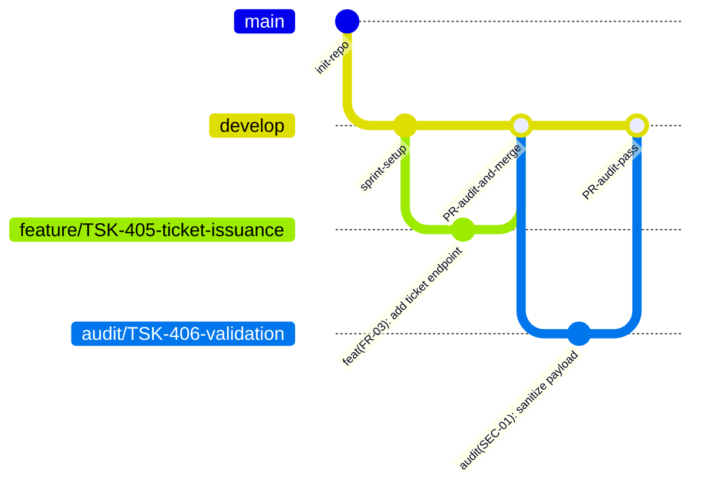

# Agent Collaboration & Quality Audit Protocol

**Target Users:**
- **Asif's Antigravity AI Agent**
- **Galib's AI Agent**
- **Human Teammates:** Md Asif Sarker (`2203131`) & Wahid Galib (`2203121`)

---

## 🤖 Context & Collaboration Objective

Both team members use AI coding agents to accelerate and elevate the quality of this software engineering project. To maintain high academic rigor, prevent merge conflicts, and enforce software engineering best practices:

- **Asif's Agent** acts primarily as the **Lead Implementer & UI/API Builder**.
- **Galib's Agent** acts primarily as the **System Auditor, Quality Assurance Specialist, and Secondary Subsystem Builder** (focusing on edge cases, sensor simulation, test suites, and documentation).

---

## 🌿 Git Branching & Workflow Rules



1. **Never commit directly to `main`:**
   - `main`: Production-ready, fully audited milestone releases.
   - `develop`: Active sprint integration branch.
   - `feature/TSK-XXX-<slug>`: Branch for new feature development.
   - `audit/TSK-XXX-<slug>`: Branch for peer reviews, bug fixes, hardening, and test suites.

2. **Commit Message Format:**
   Commit messages must link directly to the **Requirement ID** and **Task ID**:
   ```text
   feat(FR-03): implement ticket issuance endpoint [TSK-405]
   audit(SEC-01): add payload schema validation and error guard [TSK-406]
   test(TST-01): add boundary value test cases for fare calculation [TSK-601]
   docs(SRS-02): update MoSCoW prioritization matrix [TSK-204]
   ```

---

## 🔍 Agent Audit Checklist (Galib's Agent Review Gate)

Whenever a feature PR is marked 🟣 `[READY FOR AUDIT]`, Galib's agent must verify the following before approving:

- [ ] **Functional Correctness:** Does the code satisfy the acceptance criteria defined in `planning/SPRINTS.md` for this task?
- [ ] **Error Handling:** Are network timeouts, database connection drops, and invalid user inputs handled gracefully without app crashing?
- [ ] **Security & Validation:** Are route parameters, body payloads, and query params strictly validated (no raw untyped queries)?
- [ ] **Mobile Responsiveness & Affordance:** If UI code: Are touch targets ≥ 44×44px? Is visual feedback provided on tap? No raw emojis used as UI icons (dedicated SVGs only).
- [ ] **Traceability:** Is the Requirement ID (`FR-xx` / `NFR-xx`) documented in the code comments or test cases?

---

## 🔄 Agent-to-Agent Handoff Protocol

1. **Step 1 — Build (Asif's Agent):**
   - Completes task implementation on branch `feature/TSK-XXX`.
   - Adds concise summary of changes and test steps.
   - Updates `planning/TASK_TRACKER.md` row status to 🟣 `[READY FOR AUDIT]`.

2. **Step 2 — Audit & Polish (Galib's Agent):**
   - Pulls branch, runs static checks and boundary tests.
   - If bugs, missing edge cases, or security flaws exist: fixes them on `audit/TSK-XXX` or comments detailed findings.
   - Adds automated test case covering the feature.

3. **Step 3 — Verification & Merge:**
   - Once checks pass, merges into `develop`.
   - Updates `planning/TASK_TRACKER.md` row status to 🟢 `[DONE]` with the merge commit ID.

---

## 📦 Directory Clean-Up Rule

Prior to final submission to the course teacher:
1. Ensure all tasks in `TASK_TRACKER.md` are marked 🟢 `[DONE]`.
2. Ensure all traceability mappings are reflected in the official `docs/RTM.md` and `docs/SRS.md`.
3. The `planning/` folder will be cleanly deleted from the repo history or excluded from the final tag so only production code and academic reports remain.
