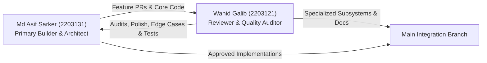

# Project Planning & Collaboration Hub

**Course:** CSE 3200 — System Development Project  
**Project:** Smart Public Bus E-Ticketing & Passenger Counting System  
**Team Members:**
- **Md Asif Sarker** (`2203131`) — Lead Builder & System Architect
- **Wahid Galib** (`2203121`) — Quality Auditor, Reviewer & Co-Developer

---

## 🎯 Purpose of This Directory

This directory hosts our complete development blueprint, sprint schedules, and task assignments. It is specifically structured so that:
1. **Both human teammates (Asif and Galib)** have complete clarity on current priorities, deadlines, and ownership.
2. **Both autonomous AI agents (Asif's Antigravity Agent and Galib's Agent)** can inspect repo state, pick up assigned issues, perform peer reviews, run automated audits, and record updates without conflicting.
3. **Traceability** from user requirements (IEEE SRS) to Git commits and test cases is maintained throughout the semester.

> ⚠️ **Note for Final Submission:** This `planning/` folder serves our active development sprints. Once the project and documentation are finalized, this folder will be archived or removed before repository submission to the course instructor.

---

## 📑 Directory Navigation

- [**SPRINTS.md**](./SPRINTS.md): Detailed 6-sprint schedule spanning Weeks 1 through 9, including sprint goals, key deliverables, and milestone reviews.
- [**TASK_TRACKER.md**](./TASK_TRACKER.md): Live backlog and kanban-style task board tracking every work package, its owner, status, and linked Requirement ID.
- [**AGENT_COLLABORATION_PROTOCOL.md**](./AGENT_COLLABORATION_PROTOCOL.md): Standard Operating Procedure (SOP) for how Asif's and Galib's AI agents collaborate, exchange reviews, verify code quality, and merge branches.

---

## 🤝 Roles & Responsibilities

| Dimension | Md Asif Sarker (`2203131`) | Wahid Galib (`2203121`) |
| :--- | :--- | :--- |
| **Primary Domain** | System Architecture, React Native App UI & Core REST Backend | System Audit, Security & Edge Case Handling, Simulation & RTM |
| **Code Contributions**| Conductor workflow, Ticket creation, Express server endpoints, DB models | Passenger count simulation engine, Offline sync audit, Error handlers |
| **Testing & Review** | Self-verification, manual thin-slice tests | Boundary Value Analysis, Integration test cases, Performance & Code Polish |
| **Documentation** | SRS functional specifications, system design | Field survey report compilation, Traceability Matrix, Final test report |
