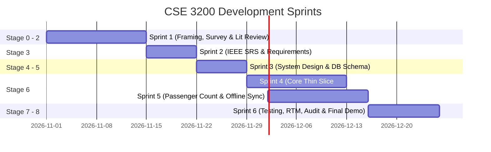

# Sprints Breakdown & Timeline

**Course:** CSE 3200 — System Development Project  
**Target:** 9-Week Delivery Cycle  

---

## 📅 High-Level Roadmap Overview

---

## 🏃 Detailed Sprint Specifications

### Sprint 1: Problem Definition & Field Elicitation (Weeks 1–2)
- **Goal:** Formalize the academic problem statement, evaluate existing regional ticketing tools, and conduct on-ground surveys with conductors and commuters.
- **Key Deliverables:**
  - `Stage 0`: Approved Problem Statement defining Problem Owners, Affected Users, and Expected Benefits.
  - `Stage 1`: Literature review comparison matrix contrasting *bdtickets*, *Shohoz*, and *Akota Transport*.
  - `Stage 2`: Field survey questionnaires (5 conductors, 10 commuters) and field observation log diary.
- **Team Split:**
  - **Asif:** Draft Stage 0 problem statement and synthesize literature review findings.
  - **Galib:** Review and polish comparison matrix; format and compile printable survey instruments (`.tex` / `.docx`).

---

### Sprint 2: Requirements Analysis & IEEE SRS (Week 3)
- **Goal:** Translate field findings into a structured IEEE 830 / ISO-IEC-IEEE 29148 compliant Software Requirements Specification.
- **Key Deliverables:**
  - Functional Requirements list with unique identifiers (`FR-01` to `FR-12`).
  - Non-Functional Requirements (`NFR-01` to `NFR-06`) covering response latency, offline capability, and security.
  - MoSCoW prioritization matrix (Must have, Should have, Could have, Won't have).
  - Use case descriptions and system boundaries.
- **Team Split:**
  - **Asif:** Define core functional requirements for ticket issuance, trip logging, and conductor actions.
  - **Galib:** Audit requirement completeness, define non-functional criteria (offline tolerance), and verify IEEE formatting standards.

---

### Sprint 3: System Design & Architectural Blueprint (Weeks 3–4)
- **Goal:** Design the client-server architecture, database collections, and sequence diagrams.
- **Key Deliverables:**
  - Architectural overview diagram (Mobile Client ↔ Express REST API ↔ MongoDB).
  - Entity-Relationship (ER) diagram / MongoDB data schemas (`Users`, `Buses`, `Routes`, `Fares`, `Trips`, `Tickets`, `PassengerCounts`).
  - Sequence diagram for ticket issuance and tap verification.
  - Technology Selection Justification Note.
- **Team Split:**
  - **Asif:** Design API route contracts, MongoDB schemas, and draft the tech selection note.
  - **Galib:** Audit schemas for data integrity/normalization, verify sequence diagrams against edge cases (e.g., failed payments, out-of-order taps).

---

### Sprint 4: Core Implementation & "Thin Slice" (Weeks 4–5)
- **Goal:** Establish a working end-to-end "thin slice": from conductor mobile app tap → backend Express REST endpoint → MongoDB transaction log.
- **Key Deliverables:**
  - Initialize Expo project (`client/`) with navigation and theme.
  - Initialize Express backend (`server/`) with MongoDB connection and error handling middleware.
  - Conductor Login & Shift Start screen.
  - Distance-based fare calculation service and ticket creation endpoint (`POST /api/tickets/issue`).
  - On-screen ticket generation with unique QR/receipt code.
- **Team Split:**
  - **Asif:** Build React Native UI screens and Express endpoints for shift and ticket creation.
  - **Galib:** Perform code audit on branch PRs, add request payload validation (e.g., using Joi/Zod), and write automated API unit tests.

---

### Sprint 5: Passenger Counting Simulation & Offline Sync (Weeks 6–7)
- **Goal:** Implement the automated passenger counting simulation module and mobile offline caching.
- **Key Deliverables:**
  - Simulated sensor module (`simulation/`): Node.js mock event generator simulating boarding/alighting events at virtual bus stops.
  - Real-time occupancy calculation (Boarded − Alighted = Current Occupancy vs. Bus Capacity).
  - Commuter mobile view: Live route stop view and bus crowding level indicator (Low / Medium / Full).
  - Offline ticket caching in React Native (`AsyncStorage`) with background sync queue upon reconnection.
- **Team Split:**
  - **Asif:** Build passenger crowd status screen and offline storage sync engine in the mobile app.
  - **Galib:** Architect and build the sensor event simulation engine; write audit tests simulating network disconnection and sync reconciliation.

---

### Sprint 6: Rigorous Testing, Traceability Matrix & Final Delivery (Weeks 8–9)
- **Goal:** Conduct multi-level testing, build the Requirement Traceability Matrix (RTM), polish UI/UX, and compile final submission artifacts.
- **Key Deliverables:**
  - Test Plan and Execution Report using Equivalence Partitioning & Boundary Value Analysis.
  - Full Requirement Traceability Matrix (`RTM.md`) linking each `FR-xx` to commit hashes and test case IDs.
  - System performance log (API latency under load, offline-to-online sync verification).
  - Final project presentation slides and user manual.
- **Team Split:**
  - **Asif:** Clean up codebase, optimize rendering and animations, record working demo walkthrough.
  - **Galib:** Complete full security and code audit, finalize RTM documentation, and prepare presentation slide deck.
